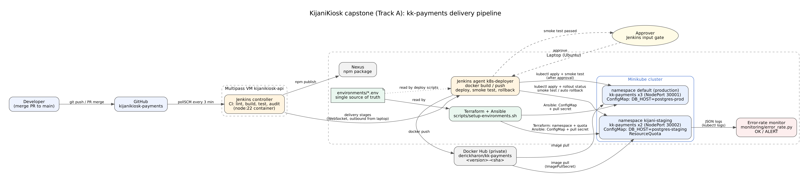

# KijaniKiosk kk-payments: staging-first delivery pipeline

## What is this?

kk-payments is the KijaniKiosk payment-validation service (Node.js 22). This repository holds the service, its container image, and a delivery pipeline that releases it safely. A merge to `main` is built and tested, packaged as an immutable `<version>-<git-sha>` image, deployed to an isolated **staging** namespace, and smoke-tested there. Only then can a person approve the release to **production**. If the staging rollout or smoke test fails, the pipeline rolls staging back automatically and stops, so an unverified version never reaches production. This closes the gap left in Week 9, where a bad image made a rollout stall until someone noticed and rolled it back by hand.

Capstone track: **A (Infrastructure-first)**. See `docs/scope.pdf`.

## Architecture



| Component | Role |
|---|---|
| **GitHub** (`main`) | Source of truth for code, manifests, infrastructure and pipeline |
| **Jenkins controller** (Multipass VM `kijanikiosk-api`) | Polls `main` every 3 minutes and runs CI (lint, build, test, audit, npm publish) in a pinned `node:22.22.0` container |
| **Jenkins agent `k8s-deployer`** (laptop) | Runs the delivery stages next to the cluster: builds and pushes the image, deploys, smoke-tests, rolls back. It connects *outwards* to Jenkins over WebSocket |
| **Docker Hub** (private `derickharon/kk-payments`) | Stores immutable images tagged `<version>-<sha>`. An existing tag is never overwritten |
| **Terraform** (`terraform/`) | Creates the `kijani-staging` namespace and its ResourceQuota |
| **Ansible** (`ansible/`) | Configures both environments: the `kk-payments-config` ConfigMap (`APP_ENV`, `DB_HOST`) and the registry pull secret |
| **`environments/*.env`** | One place for every environment name and value. Terraform, Ansible and the deploy scripts all read it |
| **Minikube** | `kijani-staging` (2 replicas, NodePort 30002) and `default` = production (3 replicas, NodePort 30001), from the **same** Deployment manifest |
| **Error-rate monitor** (`monitoring/`) | Reads the service's JSON logs and reports `ALERT` when payment errors exceed 5% for 2 consecutive minutes |

## Prerequisites

| Tool | Version used | Check |
|---|---|---|
| Docker Engine (user in the `docker` group) | 29.x | `docker version` |
| Minikube (Docker driver) | 1.39 | `minikube version` |
| kubectl | 1.37 | `kubectl version --client` |
| Terraform | ≥ 1.6 | `terraform version` |
| Ansible (with Python `kubernetes` library) | ansible-core ≥ 2.16 | `ansible --version`, `python3 -c "import kubernetes"` |
| Java (for the Jenkins agent) | 21 | `java -version` |
| Node.js (local tests only) | 22.x | `node --version` |
| Python 3 (monitor) | 3.10+ | `python3 --version` |
| Jenkins LTS with Docker Pipeline, Credentials Binding, JUnit, Workspace Cleanup | — | Jenkins UI |

Accounts and credentials (never committed):
- A Docker Hub **private** repository `kk-payments` and an access token (Read & Write), saved in a file **outside** this repo, e.g. `~/.secrets/dockerhub-token` (`chmod 600`).
- Jenkins credentials: `dockerhub-credentials` (username + token) and `nexus-credentials`.

Install on Ubuntu:
```bash
sudo apt install -y openjdk-21-jre-headless ansible python3-kubernetes
# Terraform: https://developer.hashicorp.com/terraform/install (HashiCorp apt repository)
```

## Setup (from a clean machine)

```bash
# 1. Cluster
minikube start --driver=docker
kubectl get nodes                                   # minikube   Ready

# 2. Code
git clone https://github.com/RickDerick/kijanikiosk-payments.git
cd kijanikiosk-payments

# 3. Environments: Terraform creates staging, Ansible configures staging and production
DOCKERHUB_TOKEN_FILE=~/.secrets/dockerhub-token scripts/setup-environments.sh
```

`setup-environments.sh` stops with a clear message if a tool is missing or the cluster is not running. When it finishes, it prints each environment's ConfigMap and pull-secret type.

### Jenkins agent on the laptop (one time)
1. Jenkins → **Manage Jenkins → Nodes → New Node**: name `k8s-deployer`, *Permanent Agent*, remote root `/home/<you>/jenkins-agent`, label `k8s-deployer`, executors `1`, launch method **Launch agent by connecting it to the controller**, tick **Use WebSocket**. Save.
2. Copy the secret from the node page into `~/.secrets/jenkins-agent-secret` (`chmod 600`).
3. Start the agent (keep this terminal open, or run it under `tmux`):
   ```bash
   mkdir -p ~/jenkins-agent && cd ~/jenkins-agent
   curl -sO http://10.4.110.126:8080/jnlpJars/agent.jar
   java -jar agent.jar -url http://10.4.110.126:8080/ -name k8s-deployer -webSocket \
        -secret @"$HOME/.secrets/jenkins-agent-secret" -workDir "$HOME/jenkins-agent"
   ```
   Expect `INFO: Connected`. The node page in Jenkins then shows the agent online.

## How to run the pipeline

Merge a pull request into `main`. Jenkins picks it up within 3 minutes (or click **Build Now**).

| Stage | Where | What happens |
|---|---|---|
| CI: Lint → Build → Verify (Test ‖ Audit) → Archive → Publish | controller, `node:22` container | Tests, version `<semver>-<sha>`, npm package to Nexus |
| Build Image | `k8s-deployer` | `Dockerfile.production` multi-stage build; checks the container runs as `kijani` |
| Push Image | `k8s-deployer` | Push to Docker Hub; never overwrites an existing tag |
| Deploy Staging | `k8s-deployer` | `scripts/deploy.sh staging`: checks namespace, ConfigMap and secret exist, applies, waits for rollout (≤150 s) |
| Smoke Test Staging | `k8s-deployer` | `scripts/smoke-test.sh`: version, environment, valid 202, invalid 400, correlation ID in logs |
| Error-Rate Check | `k8s-deployer` | Monitor report archived as a build artifact |
| **Approve Production** | — | Human gate showing the staging smoke result; times out after 30 min |
| Deploy + Smoke Test Production | `k8s-deployer` | Same scripts, `default` namespace |

On failure after Deploy Staging, `scripts/rollback.sh staging` runs automatically and the build is red.

## How to verify it works

```bash
# Success criterion 1: same version in both environments, different configuration
curl -s http://$(minikube ip):30002/health   # {"version":"<v>-<sha>","environment":"staging",...}
curl -s http://$(minikube ip):30001/health   # same version, "environment":"production"
kubectl -n kijani-staging get configmap kk-payments-config -o jsonpath='{.data}'; echo
kubectl -n default        get configmap kk-payments-config -o jsonpath='{.data}'; echo

# Correlation ID: one request, traceable in the logs
curl -s -H 'X-Request-Id: demo-001' http://$(minikube ip):30002/health
kubectl -n kijani-staging logs -l app=kk-payments --tail=-1 | grep demo-001

# Success criterion 2: release history shows the automatic rollback
kubectl -n kijani-staging rollout history deployment/kk-payments

# Success criterion 3: monitor
scripts/generate-traffic.sh staging 150 20     # 20% failing payments for 2.5 min
scripts/monitor-error-rate.sh staging 5m       # STATUS: ALERT
```

Operational detail (diagnosis, manual rollback, token rotation) is in `docs/runbook.md`.

## Known limitations

- **Single-node Minikube on one laptop.** If the laptop or the cluster stops, both environments stop. Fix: managed Kubernetes (EKS/GKE/AKS) with at least 3 nodes, with staging and production on separate clusters or node pools.
- **The agent deploys with the laptop user's cluster-admin kubeconfig.** Fix: a dedicated ServiceAccount per namespace with an RBAC Role limited to Deployments, Services and Pods/logs.
- **Images run as user `kijani` by name**, so `runAsNonRoot: true` cannot be enforced (Kubernetes needs a numeric UID). Fix: `USER 10001` in `Dockerfile.production` plus `runAsNonRoot: true`.
- **No Ingress or TLS;** NodePort is a lab shortcut. Fix: an Ingress controller with TLS in front of production.
- **The monitor runs on demand** (and once per pipeline run), not continuously. Fix: Prometheus with an alerting rule (or a CronJob running the same script) routed to on-call.
- **`DB_HOST` is configuration only;** kk-payments does not persist payments yet.
- **Week 10 serverless receipt chain not integrated** (not completed). The planned integration point is a receipts-bucket setting in the same ConfigMap.
- **Polling, not webhooks:** up to 3 minutes before a merge starts building, because Jenkins is not reachable from GitHub.
